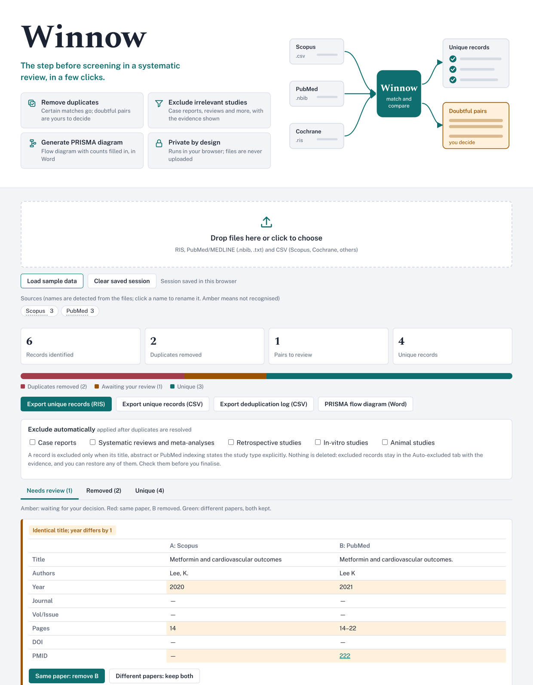

# Winnow

**Get your search results ready for screening in systematic reviews.** Winnow takes the search results you exported from Scopus, PubMed, Cochrane and other databases, removes the duplicates it is certain about, sets doubtful pairs side by side for you to resolve, and can optionally exclude records whose study type is clearly ineligible (for example case reports or systematic reviews). It then exports a clean list for your screening platform, a log of every decision, and a PRISMA 2020 flow diagram with the identification and deduplication counts filled in.

- Live tool: [winnowsr.com](https://winnowsr.com)
- Version: 0.2.0 (pilot)
- Licence: MIT

## Privacy

Winnow runs entirely in your browser. Your files are read locally and are **never uploaded** to any server. The session is saved in your browser's own storage (IndexedDB) so a reload does not lose your work. It stays on your device. Use **Clear saved session** when you finish a review.

## How to use

1. Export the results from each database (see below) and add the files to Winnow.
2. Rename the sources if needed (click a source name). Names shown in amber were not recognised; rename them to the database name so the PRISMA diagram is correct.
3. Open **Needs review** and decide each flagged pair: *Same paper* or *Different papers*.
4. Check the **Removed** tab, which lists every removal with its reason.
5. Optional: under **Exclude automatically**, tick the study types that are ineligible for your review, then check the **Auto-excluded** tab and restore any record that should be screened.
6. Export the unique records (RIS or CSV) for your screening platform, the deduplication log (CSV) and, if you used automatic exclusion, the auto-excluded records (CSV).
7. Create the PRISMA flow diagram (Word) and complete the screening fields after screening.

### Supported input

| Format | Typical source |
|---|---|
| RIS (`.ris`) | Cochrane, Scopus, Embase*, Web of Science*, reference managers |
| PubMed/MEDLINE (`.nbib`, `.txt`) | PubMed |
| CSV (`.csv`) with columns such as Title, Authors, Year, Source title, Volume, Issue, Page start/end, DOI, PubMed ID, Abstract | Scopus and others |

\*RIS from these databases may work but has not been tested. BibTeX and EndNote XML are not supported yet.

## How matching works

Titles are normalised (lower case, accents and punctuation removed) and compared using the Dice coefficient on character pairs. A candidate list is built from shared title fragments, DOI, PMID and first author plus year, so large files are not compared pair by pair.

| Condition | Action |
|---|---|
| Same DOI (titles at least 60% similar) | Remove automatically |
| Same DOI but titles differ | Flag |
| Same PMID | Remove automatically |
| Trial registry record and a publication with title at least 80% similar | Flag |
| Title at least 97% similar, but different DOIs | Flag |
| Title at least 97% similar, same year, same first author | Remove automatically |
| Title at least 97% similar, year or author differs | Flag |
| Title at least 90% similar, same year, same first author | Remove automatically |
| Title at least 80% similar, year within one, same first author or start page | Flag |
| Anything else | Treated as different records |

When a duplicate is removed, missing fields in the kept record are filled from the removed one, and every source is listed in the exports. A flagged pair keeps both records until you decide.

These thresholds are starting values and are still being validated. Do not treat them as final.

## How automatic exclusion works

Automatic exclusion is off by default and is applied only after duplicates are resolved. You choose which categories apply to your review:

| Category | Evidence used |
|---|---|
| Case reports | Title wording (e.g. "case report", "a case of"), PubMed publication type, or abstract wording such as "we report a case" |
| Systematic reviews and meta-analyses | Title wording, PubMed publication type, or abstract wording such as "this meta-analysis". Protocols are not excluded |
| Retrospective studies | "Retrospective" in the title or abstract, or the MeSH term Retrospective Studies. A mention of "prospective" in the same title or abstract prevents a match |
| In-vitro studies | "In vitro" in the title or abstract (not in-vitro fertilisation or diagnostics). A mention of in-vivo or clinical work in the same title or abstract prevents a match |
| Animal studies | Animal species or models in the title, named animal strains or procedures in the abstract, or the MeSH term Animals without Humans. A mention of patients or human participants in the same title or abstract prevents a match |

A record is excluded only when its title, abstract or PubMed indexing states the study type explicitly. Nothing is deleted:

- Every excluded record appears in the **Auto-excluded** tab with the exact evidence (for example *Title: "case report"*).
- **Keep for screening** restores a record, and the choice is remembered.
- The unique-records exports leave out auto-excluded records. Export them separately (CSV) and keep that file as your record.

Always check the auto-excluded records before you finalise.

## Outputs

- **Unique records (RIS or CSV)**, including the sources each record came from, ready to import into Rayyan, Covidence or another screening platform.
- **Deduplication log (CSV)**: every auto-removed record, every manual decision, any unresolved pair and every auto-excluded record, with the reason, plus total counts.
- **Auto-excluded records (CSV)**: category, evidence and bibliographic details for each excluded record.
- **PRISMA 2020 flow diagram (Word)**: records identified per database, duplicates removed, records marked as ineligible by automation tools (by category) and records to screen. The screening and inclusion fields are left blank for you to complete. Winnow warns you if source names were not recognised or flagged pairs are still unresolved.

## Validation (pilot)

Validation is in progress. The first pilot (version 0.1.0) compared Winnow with Rayyan on one review:

- Input: 1,836 records from four database exports.
- Winnow: 911 unique records, no flagged pairs.
- Rayyan (normal resolver): 912 records.
- Record-level comparison: the difference was two true duplicates that Rayyan kept (same DOI, garbled titles in the Scopus export) and one trial registry record that Rayyan's final list did not contain.
- All 15 records marked Included or Maybe in Rayyan were present in Winnow's list. No valid records were wrongly removed.

One review is a pilot, not evidence of accuracy. The full results will be reported in [add the paper reference], covering:

- **Duplicate removal** compared with Rayyan: false removals, missed duplicates, precision, recall and time per review.
- **Automatic exclusion**: every auto-excluded record checked manually, reporting how many relevant records were excluded by mistake in each category.

## Known limitations

- Only certain formats are supported (see above).
- Matching depends on the metadata in your exports. Records with no DOI and very short or missing titles are harder to match.
- Registry linking only flags titles that are at least 80% similar, so some registry entries will not be linked to their publication.
- Automatic exclusion relies on explicit wording in English. Records without an abstract are judged on the title and PubMed indexing only, and studies that do not state their design will not be excluded.
- Saved sessions live in one browser on one device.
- Very large files (tens of thousands of records) have not been tested.

## Reporting problems

Please open an issue on this repository, or contact [add email]. Include the file format and, if you can, a few example records (remove anything sensitive).

## How to cite

[Add the citation and Zenodo DOI once the first release is archived.]

## Licence

Released under the MIT licence. See `LICENSE`.
